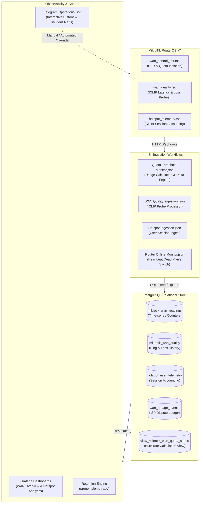

# MikroTik Quota Threshold Monitor & Policy Control Plane

[](https://opensource.org/licenses/MIT)
[](https://mikrotik.com)
[](https://www.python.org/)
[](https://www.postgresql.org/)
[](https://grafana.com/)
[](https://n8n.io/)
[](https://telegram.org/)

An enterprise-grade, distributed network automation, quota burn-rate tracking, and policy-based routing (PBR) control plane designed for **MikroTik RouterOS v7** multi-WAN environments.

---

## 📑 Table of Contents

- [Overview & Problem Statement](#-overview--problem-statement)
- [System Architecture](#-system-architecture)
- [Repository Structure](#-repository-structure)
- [Core Subsystems](#-core-subsystems)
  - [1. Dual-WAN Quota Engine](#1-dual-wan-quota-engine)
  - [2. Policy-Based Routing (PBR) Isolation](#2-policy-based-routing-pbr-isolation)
  - [3. ISP SLA Outage & Dispute Ledger](#3-isp-sla-outage--dispute-ledger)
  - [4. Hotspot Session Analytics](#4-hotspot-session-analytics)
  - [5. Interactive Telegram Operations Bot](#5-interactive-telegram-operations-bot)
  - [6. Automated Telemetry Retention Engine](#6-automated-telemetry-retention-engine)
  - [7. Zero-Touch Grafana Dashboards](#7-zero-touch-grafana-dashboards)
- [Telegram Bot Command Reference](#-telegram-bot-command-reference)
- [Step-by-Step Quickstart](#-step-by-step-quickstart)
  - [Step 1: Clone & Configure Environment](#step-1-clone--configure-environment)
  - [Step 2: Database Initialization](#step-2-database-initialization)
  - [Step 3: Deploy RouterOS Scripts](#step-3-deploy-routeros-scripts)
  - [Step 4: Import n8n Orchestration Workflows](#step-4-import-n8n-orchestration-workflows)
  - [Step 5: Launch Grafana Observability](#step-5-launch-grafana-observability)
  - [Step 6: Start the Telegram Bot Daemon](#step-6-start-the-telegram-bot-daemon)
  - [Step 7: Schedule Automated Maintenance](#step-7-schedule-automated-maintenance)
- [Verification & Testing](#-verification--testing)
- [Security & Privacy](#-security--privacy)
- [Contributing](#-contributing)
- [License](#-license)

---

## 🎯 Overview & Problem Statement

Multi-WAN deployments with metered monthly allowances (e.g. DSL, Fiber, or 4G/5G backup links with Fair Usage Policies) frequently suffer from three critical challenges:

1. **Uncontrolled Overage & Degradation**: When a metered interface reaches 100% capacity, ISPs either drop speeds down to an unusable 256 kbps or apply punitive per-gigabyte overage charges.
2. **Asymmetric Billing Cycles & Invisible Burn Rates**: Multiple uplinks from different providers (e.g., Vodafone DSL and Telecom Egypt / WE VDSL) operate on differing renewal dates, making unified tracking difficult.
3. **Lack of Verifiable ISP Outage Records**: Intermittent micro-outages or excessive latency degrade user experience, but subscribers lack immutable, timestamped ICMP logs to substantiate SLA compensation claims.
4. **Hotspot Client Abuse**: Individual rogue clients or bandwidth hogs on internal Hotspot networks can consume gigabytes in hours without immediate administrator visibility.

### The Solution

This project implements an end-to-end, automated loop:
- **RouterOS v7 Telemetry**: Scheduled scripts stream interface byte counters, ICMP latency/loss probes, and active Hotspot sessions via HTTP webhooks.
- **n8n Orchestration**: Ingests payloads, calculates exact byte delta increments, and evaluates quota threshold events.
- **PostgreSQL Relational Ledger**: Stores time-series telemetry, billing cycle definitions, and ISP outage incidents.
- **Automated PBR Isolation**: Automatically marks connections and routes traffic away from exhausted links to protect the network from penalties.
- **Telegram Operations Bot**: Delivers real-time Arabic & English threshold alerts (80%, 95%, 100%) and provides dual-row interactive control buttons.
- **Zero-Touch Grafana Stack**: Visualizes burn rates, SLA health, and per-user Hotspot metrics out-of-the-box.

---

## 🏗️ System Architecture



---

## 📂 Repository Structure

The codebase is organized into modular, domain-specific directories:

```
.
├── bot/                                   # Telegram Operations Bot & daemons
│   ├── telegram_bot_daemon.py             # Multi-threaded bot daemon (Local environment)
│   ├── telegram_bot_daemon_oci.py         # Production OCI daemon (Zero-dependency .env loader)
│   ├── install_bot_service.py             # Systemd service installer for Linux hosts
│   └── deploy_bot_dual_keyboard.py        # Interactive dual-row keyboard configurator
├── dashboards/                            # Grafana dashboard definitions & panel tools
│   ├── mikrotik-overview-upgraded.json    # Upgraded Grafana overview dashboard model
│   ├── updated_wan_dashboard.json         # WAN traffic & quota dashboard
│   ├── hotspot_dashboard_backup.json      # Hotspot user dashboard model
│   └── run_all_dashboards.py              # Automated dashboard validator & exporter
├── database/                              # PostgreSQL DDL, views, and migration scripts
│   ├── schema.sql                         # Complete database schema, views, and seed data
│   ├── schema_production_actual.sql       # Reference production DDL snapshot (72 tables)
│   ├── insert_quality_wf.sql              # Quality metrics SQL schema definition
│   └── check_billing_tables.py            # Billing cycle and view inspection tool
├── deploy/                                # Server deployments & reverse proxy configs
│   ├── docker-compose.server.yml          # Dual-network production server compose stack
│   ├── n8n_compose_patched.yml            # Patched n8n compose with database bridge
│   └── mikrotik.example.com.conf          # Nginx reverse proxy SSL configuration
├── docs/                                  # Engineering documentation & operational runbooks
│   ├── PRODUCTION_ROLLOUT.md              # 5-phase production deployment verification guide
│   ├── QUOTA_ALERT_BEHAVIOR.md            # Quota threshold state machine specifications
│   ├── ROLLBACK_PROCEDURE.md              # Emergency rollback and failover runbooks
│   ├── INGESTION_REPAIR.md                # Docker network root-cause analysis runbook
│   └── DRY_RUN.md                         # Offline quota simulation documentation
├── maintenance/                           # Data retention engine & background pruning
│   ├── prune_telemetry.py                 # Chunked, non-locking historical log cleaner
│   └── test_prune_telemetry.py            # Unit tests for telemetry retention engine
├── provisioning/                          # Grafana zero-touch provisioning stack
│   ├── dashboards/                        # Provisioned dashboard models & provider YAML
│   └── datasources/                       # Pre-configured PostgreSQL datasource YAML
├── routeros/                              # MikroTik RouterOS v7 scripts (.rsc)
│   ├── wan_control_pbr.rsc                # Policy-based routing and isolation logic
│   ├── wan_quality.rsc                    # ICMP probe for latency & packet loss
│   ├── hotspot_telemetry.rsc              # Active hotspot client telemetry collector
│   ├── wccp_control.rsc                   # WCCP cache redirection and override helper
│   └── router_config_clean.rsc            # Sanitized reference router configuration export
├── tests/                                 # Unit, integration, and security test suites
│   ├── test_quota_alert_dry_run.py        # Offline quota state machine unit tests
│   ├── test_quality_webhook.py            # Webhook latency test runner
│   └── test_network_isolation.sh          # Network container isolation test suite
├── tools/                                 # Operational utilities, diagnostics, dispatchers
│   ├── quota_alert_dry_run.py             # Offline CLI quota simulator
│   ├── query_telemetry.py                 # Ad-hoc telemetry inspection utility
│   ├── dispatch_correct_vf.py             # Vodafone notification dispatcher
│   └── remote_cmd.py                      # SSH operational command runner
├── workflows/                             # n8n Orchestration workflows (.json)
│   ├── MikroTik - Quota Threshold Monitor.json # Core quota tracking & alert pipeline
│   ├── MikroTik - WAN Quality Ingestion.json   # Latency & packet loss processor
│   ├── MikroTik - Hotspot Ingestion.json       # Hotspot user metrics ingestion
│   ├── MikroTik - Telegram Interactive Bot.json# Telegram callback handler workflow
│   └── MikroTik - Router Offline Monitor.json  # Router heartbeat & offline monitor
├── .agents/                               # LLM & Agentic navigation layer
│   ├── context/                           # System architecture, codebase maps, data flows
│   └── scripts/validate_codebase_map.py   # Drift detection and validation script
├── docker-compose.monitoring.yml          # Grafana monitoring container stack
├── DEPLOYMENT.md                          # 5-phase production deployment guide
├── SERVICE_HEALTH_MATRIX.md               # Health verification checklist & metric standards
├── AGENTS.md                              # Agent operating instructions & safety rules
├── .env.example                           # Sample environment configuration template
├── LICENSE                                # MIT License
└── README.md                              # Project documentation
```

---

## ⚙️ Core Subsystems

### 1. Dual-WAN Quota Engine
- **Byte-Accurate Delta Tracking**: Reads cumulative `rx-byte` and `tx-byte` counters from RouterOS interfaces, accounting for router reboots and counter resets.
- **Three-Tier Threshold State Machine**: Evaluates status on every cycle and generates alerts at:
  - **80% (Warning)**: Early notification with projected days remaining at current burn rate.
  - **95% (Critical)**: Imminent exhaustion alert recommending bandwidth throttling.
  - **100% (Exhaustion)**: Triggers policy-based routing isolation to prevent overage.
- **Deduplication Logic**: State recorded in `quota_alert_state` ensures alerts are sent once per threshold per monthly cycle.

### 2. Policy-Based Routing (PBR) Isolation
- Implemented in [`routeros/wan_control_pbr.rsc`](file:///d:/Work/MikroTik%20-%20Quota%20Threshold%20Monitor/routeros/wan_control_pbr.rsc) and [`routeros/wccp_control.rsc`](file:///d:/Work/MikroTik%20-%20Quota%20Threshold%20Monitor/routeros/wccp_control.rsc).
- Utilizes RouterOS v7 routing tables (`to_WAN1`, `to_WAN2`) and connection marks.
- **Survivor Check**: Ensures that before an exhausted link is isolated, the remaining uplink is verified online, preventing accidental total network blackout.

### 3. ISP SLA Outage & Dispute Ledger
- Implemented in [`routeros/wan_quality.rsc`](file:///d:/Work/MikroTik%20-%20Quota%20Threshold%20Monitor/routeros/wan_quality.rsc).
- Sends periodic 3-packet ICMP probes to external gateways (e.g., `8.8.8.8`, `1.1.1.1`).
- Records min/avg/max latency, jitter, and packet loss in `mikrotik_wan_quality`.
- Detects continuous packet loss and logs outage intervals into `wan_outage_events` to provide proof for ISP customer support compensation requests.

### 4. Hotspot Session Analytics
- Implemented in [`routeros/hotspot_telemetry.rsc`](file:///d:/Work/MikroTik%20-%20Quota%20Threshold%20Monitor/routeros/hotspot_telemetry.rsc).
- Batches active client data: IP address, MAC address, uptime, bytes in/out, and voucher profile.
- Detects top consumers and tracks voucher expiration in real-time.

### 5. Interactive Telegram Operations Bot
- Implemented in [`bot/telegram_bot_daemon.py`](file:///d:/Work/MikroTik%20-%20Quota%20Threshold%20Monitor/bot/telegram_bot_daemon.py) and [`bot/telegram_bot_daemon_oci.py`](file:///d:/Work/MikroTik%20-%20Quota%20Threshold%20Monitor/bot/telegram_bot_daemon_oci.py).
- Zero external framework dependencies (uses `requests` and `psycopg2-binary`).
- Features interactive reply keyboard markup in Arabic and English for rapid network diagnostics without typing commands.

### 6. Automated Telemetry Retention Engine
- Implemented in [`maintenance/prune_telemetry.py`](file:///d:/Work/MikroTik%20-%20Quota%20Threshold%20Monitor/maintenance/prune_telemetry.py).
- Non-locking, bounded chunked deletion (1,000 rows per transaction) to prevent table locks on high-write production databases.
- Retention windows: 14 days for high-frequency ICMP pings, 30 days for Hotspot user sessions.

### 7. Zero-Touch Grafana Dashboards
- Pre-configured provisioning stack in [`provisioning/`](file:///d:/Work/MikroTik%20-%20Quota%20Threshold%20Monitor/provisioning).
- Launches instantly with `docker compose -f docker-compose.monitoring.yml up -d` with pre-wired PostgreSQL queries for live bandwidth gauges, daily usage histograms, and latency percentiles.

---

## 🤖 Telegram Bot Command Reference

The Telegram Daemon provides both command-based and on-screen button interactions:

| Command | Button (Arabic) | Function | Description |
|---|---|---|---|
| `/status` | 📊 حالة الباقات | **Package Balance** | Shows real-time usage, remaining GBs, and percent used for WAN1 & WAN2 |
| `/failover` | 🔀 تشخيص الفيل-أوفر | **Failover Diagnostic** | Evaluates latency, packet loss, and routing table health across both uplinks |
| `/hotspot` | 👥 مستخدمي الهوتسبوت | **Hotspot Analytics** | Displays active user sessions, top bandwidth consumers, and uptime |
| `/claim` | 📝 مطالبة تعويض | **ISP Claim Generator** | Compiles recent outage timestamps and durations formatted for ISP escalation |
| `/help` | ❓ المساعدة | **Command List** | Displays available commands and administrative instructions |

---

## 🚀 Step-by-Step Quickstart

### Step 1: Clone & Configure Environment

Clone the repository and prepare your environment settings:
```bash
git clone https://github.com/geocanal/MikroTik-Quota-Threshold-Monitor.git
cd MikroTik-Quota-Threshold-Monitor
cp .env.example .env
```

Edit `.env` with your secure configuration:
```env
TELEGRAM_BOT_TOKEN=123456789:ABCdefGhIJKlmNoPQRsTUVwxyZ_example
TELEGRAM_ADMIN_CHAT_ID=123456789
GRAFANA_ADMIN_USER=admin
GRAFANA_ADMIN_PASSWORD=admin
GRAFANA_PORT=3000
DB_HOST=127.0.0.1
DB_PORT=5432
DB_NAME=mikrotik_db
DB_USER=mikrotik
DB_PASSWORD=your_secure_password
```

### Step 2: Database Initialization

Create your PostgreSQL database (version 15+ recommended) and apply the complete DDL:
```bash
psql -h $DB_HOST -U $DB_USER -d $DB_NAME -f database/schema.sql
```

### Step 3: Deploy RouterOS Scripts

1. Connect to your MikroTik router via WinBox or SSH.
2. Upload and install the scripts from [`routeros/`](file:///d:/Work/MikroTik%20-%20Quota%20Threshold%20Monitor/routeros):
   - **`routeros/wan_quality.rsc`**: Add to `/system script` and schedule every 2 minutes:
     ```routeros
     /system scheduler add name="schedule-wan-quality" interval=2m on-event=probe_wan_quality
     ```
   - **`routeros/hotspot_telemetry.rsc`**: Add to `/system script` and schedule every 5 minutes:
     ```routeros
     /system scheduler add name="schedule-hotspot-telemetry" interval=5m on-event=push_hotspot_telemetry
     ```
   - **`routeros/wan_control_pbr.rsc`**: Import routing tables and mangle rules:
     ```routeros
     /import file-name=wan_control_pbr.rsc
     ```

### Step 4: Import n8n Orchestration Workflows

1. Open your n8n web dashboard.
2. Navigate to **Workflows -> Import from File** and import:
   - [`workflows/MikroTik - Quota Threshold Monitor.json`](file:///d:/Work/MikroTik%20-%20Quota%20Threshold%20Monitor/workflows/MikroTik%20-%20Quota%20Threshold%20Monitor.json)
   - [`workflows/MikroTik - WAN Quality Ingestion.json`](file:///d:/Work/MikroTik%20-%20Quota%20Threshold%20Monitor/workflows/MikroTik%20-%20WAN%20Quality%20Ingestion.json)
   - [`workflows/MikroTik - Hotspot Ingestion.json`](file:///d:/Work/MikroTik%20-%20Quota%20Threshold%20Monitor/workflows/MikroTik%20-%20Hotspot%20Ingestion.json)
3. Connect your PostgreSQL credentials in n8n and toggle each workflow to **Active**.

### Step 5: Launch Grafana Observability

Start the provisioned monitoring container:
```bash
docker compose -f docker-compose.monitoring.yml up -d
```
Access Grafana at `http://localhost:3000` (default: `admin` / `admin`). The **MikroTik Overview** and **Hotspot Overview** dashboards load automatically with zero manual setup.

### Step 6: Start the Telegram Bot Daemon

Install Python dependencies and start the daemon:
```bash
pip install requests psycopg2-binary
python bot/telegram_bot_daemon.py
```

*For Linux server deployments*, install as a systemd service:
```bash
python bot/install_bot_service.py
sudo systemctl enable --now mikrotik-telegram-bot
```

### Step 7: Schedule Automated Maintenance

Add the telemetry pruning job to the server crontab to prevent disk bloat:
```bash
# Run daily at 03:00 AM
0 3 * * * /usr/bin/python3 /path/to/MikroTik-Quota-Threshold-Monitor/maintenance/prune_telemetry.py >> /var/log/prune_telemetry.log 2>&1
```

---

## 🧪 Verification & Testing

The repository includes a comprehensive test suite to ensure system stability:

```bash
# 1. Run retention engine unit tests
python -m unittest maintenance/test_prune_telemetry.py

# 2. Run offline quota alert dry-run tests
python -m unittest tests/test_quota_alert_dry_run.py

# 3. Verify codebase navigation maps and detect drift
python .agents/scripts/validate_codebase_map.py
```

---

## 🛡️ Security & Privacy

- **Zero-Secret Guarantee**: No API keys, bot tokens, or passwords are hardcoded in the codebase.
- **Decoupled Configuration**: All credentials reside in `.env` files protected by `.gitignore` and restrictive file permissions (`chmod 600`).
- **RFC-5737 Compliant**: All public documentation, diagrams, and example configurations use reserved test IP addresses (`198.51.100.x`) and `example.com`.
- **Sanitized Git History**: Clean commit history vetted against secret scanners.

---

## 🤝 Contributing

Contributions are welcome! Please follow these steps:

1. Fork the repository.
2. Create your feature branch (`git checkout -b feature/NewFeature`).
3. Commit your changes (`git commit -m 'feat: add NewFeature'`).
4. Run all unit tests and the navigation validator (`python .agents/scripts/validate_codebase_map.py`).
5. Push to the branch (`git push origin feature/NewFeature`).
6. Submit a Pull Request.

---

## 📄 License

This project is licensed under the MIT License - see the [`LICENSE`](file:///d:/Work/MikroTik%20-%20Quota%20Threshold%20Monitor/LICENSE) file for details.
